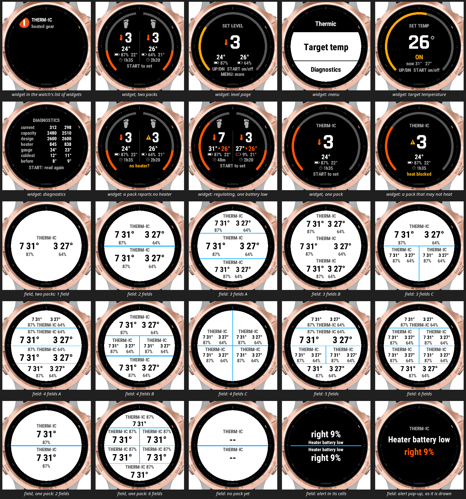

# Connect IQ apps for Therm-ic heated gear

Control Therm-ic heated socks and other heated gear from a Garmin watch, without taking
the phone out.

Unofficial. Not affiliated with or endorsed by Therm-ic or Garmin.

## Status

Experimental, and **not yet tried on real hardware**.

- The widget and the data field both work against the pack emulator in this repository,
  on a fenix 6S Pro (Connect IQ 3.4.5). The widget finds the pack, connects, reads level
  and battery, follows notifications and sets the level. The data field does the same
  without ever writing, shows the values during an activity and records them into the
  activity's FIT file.
- While an activity records, the level cannot be changed from the watch: a data field
  gets no button presses, and this watch does not open widgets then. Use the button on
  the pack; the field follows it.
- The temperature shown is what a pack calls its external temperature. Whether real
  socks have a sensor for it is not known; the phone app has a case for gear without one.
- Known problem: in one recording the recorded fields stopped at the moment the widget
  app shut down, after the widget list had started it. Not understood yet. Until it is,
  stay out of the widget list while recording.
- The official phone app works against the same emulator, which is how the protocol
  was confirmed.
- Open question: the phone app bonds with the pack, and watches on Connect IQ 3.x cannot
  bond. If a real pack refuses an unbonded connection, the widget will show
  `needs bonding` and direct control from such a watch is not possible. See
  [docs/protocol.md](docs/protocol.md).
- Two packs at once (left and right) are implemented but untested.

## Screens



Taken in the simulator with made-up packs. The first two rows are the widget. The next
two are the data field with two packs in each of the watch's ten layouts. The last row
is the data field with one pack and with none, and its alert: in the field's own cells,
and as the pop-up draws it. The simulator does not show that pop-up for this watch, so
the last picture is its drawing run in a cell of the field.

## What is here

| Path        | What |
|-------------|------|
| `widget/`    | The widget: level and battery on the main page, level control on a second page. |
| `datafield/` | A data field: level and battery on an activity's data screen, recorded with the activity. |
| `common/`    | Code shared by the apps: protocol constants, state model, Bluetooth and demo transports. |
| `probe/`     | Diagnostic widget that shows every step of scan, connect, read and write. |
| `emulator/`  | A Bluetooth LE peripheral that imitates a pack, for Linux with BlueZ. |
| `tools/`     | Headless simulator, SDK Manager container, icon helper, FIT file dump. |
| `docs/`      | Protocol notes. |

## Using the widget

In the watch's list of widgets it shows its name only. It starts looking for packs once
it is opened.

Main page with one pack: the level as a number and a ring. Under it, line by line: the
temperature at the gear, the battery with the temperature inside the pack next to it,
and how long the pack expects its heat to last.

Main page with two packs: a column for each under a left and a right foot. Each has its
own half of the ring, its level and the same lines.

The temperature at the gear is left out when the gear reports none. While a pack
regulates to a target temperature, the target follows the reading: `24° ▸ 27°`.

The watch cannot tell which pack is on which foot: the first one to connect is shown on
the left, and that can differ from one time to the next. Press the button on a pack to
see which column changes.

- START opens the level page.
- UP and DOWN are left to the watch, so the widget loop keeps scrolling.

Level page:

- UP and DOWN change the level, 0 to 10. Several quick presses become one write.
- START switches the heat off, or back to the last level that was on.
- MENU, a long press of UP, opens a menu with the two pages below.
- BACK returns to the main page.

Target temperature page, for gear that reports a temperature:

- UP and DOWN change the target, 15 to 35 degrees Celsius. The packs keep it.
- START turns the regulation to that target on or off.

Diagnostics page: current consumption, capacity, the capacity the battery was designed
for, heater resistance, the temperature of the fuel gauge chip and the lowest
temperature inside the pack, now and before. Read when the page opens and again on
START. Numbers are shown as the pack gives them where their unit is not known.

A yellow warning sign takes the place of the thermometer when a pack says something is
wrong, with a word about it on the bottom line: `heat blocked` when the pack does not
let itself heat, `no heater?` when it reports a heater resistance of 65535. The second
is a guess at what that value means.

What a pack does with its level while it regulates, and whether it goes on regulating
with nothing connected, is not known yet.

The widget never writes to a pack on its own. A level changed with the button on the
pack shows up on the watch, and the level page continues from that value.

## Using the data field

Add the field named Thermic to a data screen of an activity. Under its label,
`THERM-IC`, it shows numbers and no icons, as large as its cell allows:

- one pack: `7 24°` with `64%` under it - level 7, 24 degrees at the gear, battery at
  64 percent.
- two packs: the same twice, the first pack in the left half of the cell and the second
  in the right half.
- `7` without a temperature when the gear reports none.
- `--` - no pack found yet. `...` - connecting.
- a short message such as `needs bonding` when something went wrong.

A cell too low for three lines gets two: the label shares a line with the batteries,
`THERM-IC 64%` or `87% THERM-IC 64%`. The label is left out only where it would make
the numbers smaller: with two packs, in the lowest cell at the bottom of the screen.

As in the widget, the first pack to connect is the one on the left.

With every record of the activity it stores the level, the temperature and the battery,
and in the summary the battery used since the timer started. With two packs it keeps one
value of each kind: the highest level, the lowest temperature and the lowest battery.
The temperature is recorded in degrees Celsius whatever unit the watch shows. While no
pack is connected the recorded fields hold FIT's "no value", so the recording has a gap
there.

The field warns when a pack's battery is at 10 percent or below, and when a pack is
lost. For ten seconds its cell turns to inverted colours and reads like a field of the
watch itself, words above a value: `Heater battery low` over `9%`, or
`Heater connection` over `LOST`. With two packs the value names the side, `right 9%`,
and a lost pack reads `1 of 2 heaters` over `LOST`. In a narrow cell the words get
shorter. The watch vibrates, and a pop-up with the same words is asked for as well.

The field only listens. A data field gets no button presses on a watch with buttons, so
it cannot change the level and never writes to a pack.

To spare the watch's battery the apps do not look for packs all the time. They search
without a break for a minute after the start and after a pack comes or goes, then for 12
seconds of every minute, and after ten more minutes for 12 seconds of every five. A pack
switched on in the middle of an activity is therefore picked up within minutes, not at
once.

It is built for the fenix 6S Pro only: a data field has 128 KB there and 32 KB on the
plain fenix 6S.

Whether Garmin Connect displays these fields for an app that is not in the Connect IQ
Store is not known. `tools/fitdump.py activity.fit` prints what is in the file.

## Building

Needs the Connect IQ SDK with the device files for your watch, and a developer key.

```bash
# once: a signing key
openssl genrsa -out developer_key.pem 4096
openssl pkcs8 -topk8 -inform PEM -outform DER -in developer_key.pem -out developer_key.der -nocrypt

SDK="$(tr -d '\n' < ~/.Garmin/ConnectIQ/current-sdk.cfg)"
"$SDK/bin/monkeyc" -d fenix6spro -f widget/monkey.jungle -o widget/bin/THERMIC.prg -y developer_key.der -w
"$SDK/bin/monkeyc" -d fenix6spro -f datafield/monkey.jungle -o datafield/bin/THERMICF.prg -y developer_key.der -w
```

Keep the key out of the repository. `.gitignore` covers `*.der` and `*.pem`.

Supported devices are listed in `widget/manifest.xml`. To add one, add its product id
there and download its device files with the SDK Manager. The pack family is a constant
in `common/source/Protocol.mc`; the watch registers at most three Bluetooth profiles, so
one family is compiled in.

### SDK Manager on a current Linux

Garmin's SDK Manager and simulator link to WebKitGTK 4.0, which Ubuntu 24.04 and its
derivatives no longer ship. Pointing the 4.0 library name at 4.1 does not work.
`tools/sdkmanager/` runs the official binary in an Ubuntu 22.04 container instead:

```bash
tools/sdkmanager/run.sh /path/to/unpacked/connectiq-sdk-manager-linux
```

The compiler itself is Java and runs on the host.

## Installing on the watch

Connect the watch by USB and copy the `.prg` into `GARMIN/Apps`. Music models show up as
an MTP device, the others as a drive. To get the app's log, create an empty
`GARMIN/Apps/LOGS/THERMIC.TXT` first; the name must match the `.prg`.

## Trying it without hardware

### Pack emulator

`emulator/pack_emulator.py` registers the pack's services with BlueZ and advertises
them. It logs every read, write and subscription and has a small console to play the
pack's side, for example a press of its button.

```bash
python3 emulator/pack_emulator.py --log session.log
# then, in its console:
#   heat 7        the pack changes level by itself
#   battery 50
#   ext 31        temperature at the gear
#   int 12        temperature inside the pack
#   res 65535     heater resistance; this value is what "no heater?" reacts to
#   allowed 0     the pack does not let itself heat
#   drop          cut the link, as when the pack goes out of range
#   show
#   quit          cut the link and stop, as when the pack is switched off
```

Requirements: BlueZ with a controller that supports the peripheral role, `python3-dbus`
and `python3-gi`.

BlueZ publishes a Device Information service of its own, without the characteristics
the official app looks for, and it comes first. To test with the official app, set
`DeviceID = false` in the `[General]` section of `/etc/bluetooth/main.conf` and restart
the bluetooth service. The widget does not need this.

The official app will bond with the computer running the emulator, and it wants two
packs for socks; choose a product that uses a single pack. Turn the phone's Bluetooth
off while testing the watch, or the app reconnects and gets in the way.

### Demo build and headless simulator

The demo build replaces Bluetooth with two made-up packs:

```bash
"$SDK/bin/monkeyc" -d fenix6spro -f widget/monkey-demo.jungle -o widget/bin/THERMICD.prg -y developer_key.der -w
```

`tools/simulator/` runs Garmin's simulator on a virtual display, sends key presses and
saves screenshots, so screens can be checked without a watch:

```bash
docker build -t ciq-sdkmanager:jammy tools/sdkmanager     # base image
docker build -t ciq-sim:jammy tools/simulator
tools/simulator/run.sh widget/bin/THERMICD.prg fenix6spro /tmp/shots \
    shot:a-glance \
    click:73,12 wait:1 tap:141,534 wait:1 key:Right key:Return wait:3 \
    wait:4 shot:b-main key:Return wait:1 shot:c-level key:Up wait:2 shot:d-up
```

The simulator starts the widget the way the watch's list of widgets does, as a glance.
The second line of steps chooses Settings > Glance Launch Mode > Launch in Normal Mode,
which opens it in full.

The simulator has no Bluetooth; use it with the demo build.

The data field has a demo build too (`datafield/monkey-demo.jungle`). To check what it
records, let the simulator record an activity and save the FIT file. The steps below
open Simulation > Activity Data and press Start, Stop, Save and Save Fit Data:

```bash
tools/simulator/run.sh datafield/bin/THERMICFD.prg fenix6spro /tmp/shots \
    click:150,12 wait:1 click:176,58 wait:2 \
    tap:60,275 wait:15 tap:60,275 wait:2 tap:267,275 wait:3 \
    tap:423,172 wait:3 key:ctrl+a type:/work/out/session.fit key:Return wait:3
python3 tools/fitdump.py /tmp/shots/session.fit
```

The coordinates fit the simulator of SDK 9.3.0. If they stop working, add a
`screen:<name>` step to see where the buttons are.

## Branding

The repository ships a neutral launcher icon. `widget/monkey.jungle` lists a second,
optional resource directory, `private/widget/resources`, which is ignored by git.
Resources placed there override the shipped ones with the same id, so a private build
can carry its own icon. `tools/make_icon.py` produces one from a logo you supply.

Therm-ic and its logo are trademarks of their owner. Do not publish builds that use them
without permission.

## Licence

MIT, see [LICENSE](LICENSE). It covers the code and the documents in this repository.
It gives no rights to the names and logos of Therm-ic or Garmin, and it does not cover
the picture of the watch in `docs/screens.png`, which comes from Garmin's simulator.

## How the protocol was worked out

By reading the official Android app and by letting it talk to the emulator. No code from
that app is included here; see [docs/protocol.md](docs/protocol.md) for what was
learned and how sure each part is.
